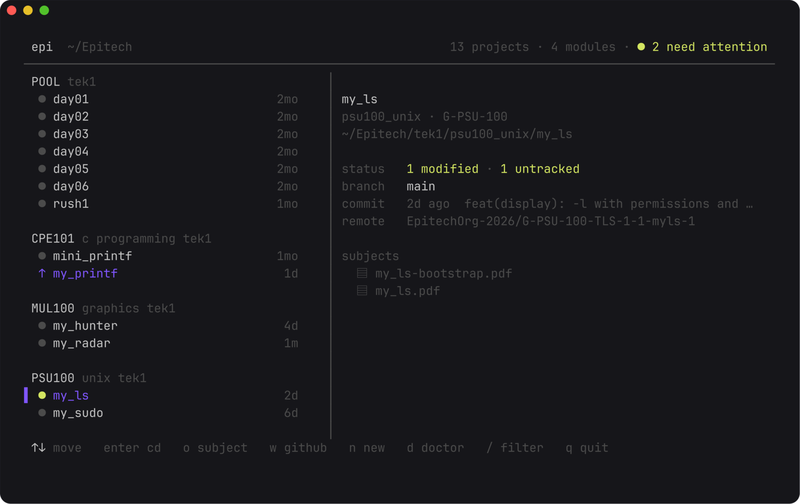

<p align="center">
  
</p>

<h1 align="center">epi</h1>

<p align="center">
  Keeps your Epitech folder organized.
</p>

<p align="center">
  <a href="https://github.com/cempack/epi/releases/latest"></a>
  <a href="https://github.com/cempack/epi/actions/workflows/ci.yml"></a>
  
  
  <a href="https://epitech.elliotmoreau.fr"></a>
  <a href="LICENSE"></a>
</p>

<p align="center">
  
</p>

epi clones new projects from GitHub into the right place, with the right name,
files their subjects (main, bootstrap, kickoff, roadmap, annexes) next to them,
manages `bootstrap/` workspaces, and tells you what needs attention.

```
~/Epitech/
  docs/                    coding_style.pdf, conventional_commits.pdf, …
  tek1/
    pool/                  day01 … day13, rush1, rush2, star, subjects/
    cpe101_c_programming/  mini_printf, my_printf, subjects/
    psu100_unix/           my_ls, my_sudo, subjects/
    mul100_graphics/       my_hunter, my_radar, subjects/
```

## Install

It comes with [epitech-toolkit](https://github.com/cempack/epitech-toolkit),
which keeps it updated. On its own, take the binary from the
[latest release](https://github.com/cempack/epi/releases/latest):

```sh
curl -fsSL -o ~/.local/bin/epi https://github.com/cempack/epi/releases/latest/download/epi-linux-amd64
chmod +x ~/.local/bin/epi
echo 'command -v epi >/dev/null && eval "$(command epi shell)"' >> ~/.bashrc
```

The last line lets plain `epi` and `epi cd <query>` move your shell into the
project (or `bootstrap/`) you pick. Optional tab completion:
`eval "$(command epi completion bash)"` (or `zsh`).
epi needs [`gh`](https://cli.github.com) logged in (`gh auth login`) and, to
read/search subject PDFs, `pdftotext` (poppler).

## Use

| | |
|---|---|
| `epi` | Interactive dashboard: browse projects by module or recent activity (`t`), collapse modules (`space`), `enter` to cd, `b` to cd into `bootstrap/` (or initialize it), `o` to open/pick any subject, `B` for bootstrap PDF, `s` to file subjects, `e` for `$EDITOR`, `L` for `lazygit`, `p` for `epitech-predeliver`, `D` for `~/Epitech/docs`, `r` to fetch all remotes, `/` to filter. |
| `epi new [repo]` | Lists uncloned Epitech repos on GitHub (or resolves a name/slug/URL), clones it, files matching subjects from `~/Downloads`, and offers to set up `bootstrap/` + `.gitignore`. |
| `epi cd [query]` | Fuzzy-jump straight into a project (`epi cd radar`), module (`epi cd pool`), or bootstrap (`epi cd sudo/b`). |
| `epi open [proj] [kind]` | Open a project's subject (`epi open sudo kickoff`, `epi open hunter boot`, `epi open sudo all`, or pick interactively). |
| `epi subject [proj] [files...]` | File subjects from `~/Downloads` or explicit paths into a project, with kind/suffix selection (`main`, `bootstrap`, `kickoff`, `roadmap`, `annex`, `bonus`, `slides`, `examples`, or custom) and duplicate/update handling. |
| `epi bootstrap [proj]` | Create/tidy `<project>/bootstrap/`, add `.gitignore` rules for compiled binaries (or all of `bootstrap/`), clean stray binaries, and open the bootstrap PDF. |
| `epi doctor` | Checks naming, placement, bootstrap hygiene (stray binaries or tracked `bootstrap/` in delivery repos), unsaved/behind work, clutter, bootstrap-only vs missing subjects, uncloned repos, and interactively files new/updated PDFs or cleans duplicates & junk. |
| `epi allowed [proj] [--save]` | Extracts authorized/forbidden functions from the project's main subject PDF. With `--save`, writes the list directly for `epitech-predeliver`. |
| `epi search <query>` | Concurrent full-text search across every filed subject PDF and `~/Epitech/docs`. |
| `epi sync` | Runs `git fetch --all --prune` concurrently across all repos and reports behind/ahead counts. |
| `epi docs [query]` | Open a reference PDF from `~/Epitech/docs`. |

## How it decides

- **Where.** The repository name says it all: `G-PSU-100-TLS-1-1-myls-1` is
  module PSU-100 of the first year, so it goes in `tek1/psu100_unix/`. The pool
  (CPE-100) goes in `tek1/pool/`. For a module it has never seen, epi asks a
  short topic once, then reuses the folder.
- **The name.** Repository names lose their separators (`myls`, `settingup`);
  subject titles keep them (`MY_LS`, `SETTING UP`). epi reads the first page of
  the subject and keeps the words that spell the repository's name: `my_ls`,
  `setting_up`.
- **Multiple subjects.** Subjects are ordered semantically (`main` → `bootstrap`
  → `kickoff` → `roadmap` → `annex` → `bonus` → `slides` → `examples`) and
  compared by SHA256 so `epi doctor` tells identical downloads apart from
  updated subject versions.
- **Nothing happens before you confirm.** Files are moved, never overwritten
  without asking.

## Settings

| Variable | Default |
|---|---|
| `EPI_ROOT` | `~/Epitech` |
| `EPI_DOWNLOADS` | `~/Downloads` |

## Build

```sh
go build -o ~/.local/bin/epi .
go test ./...
```

Releases are built by GitHub Actions when a `v*` tag is pushed.

Unofficial: not affiliated with Epitech.
